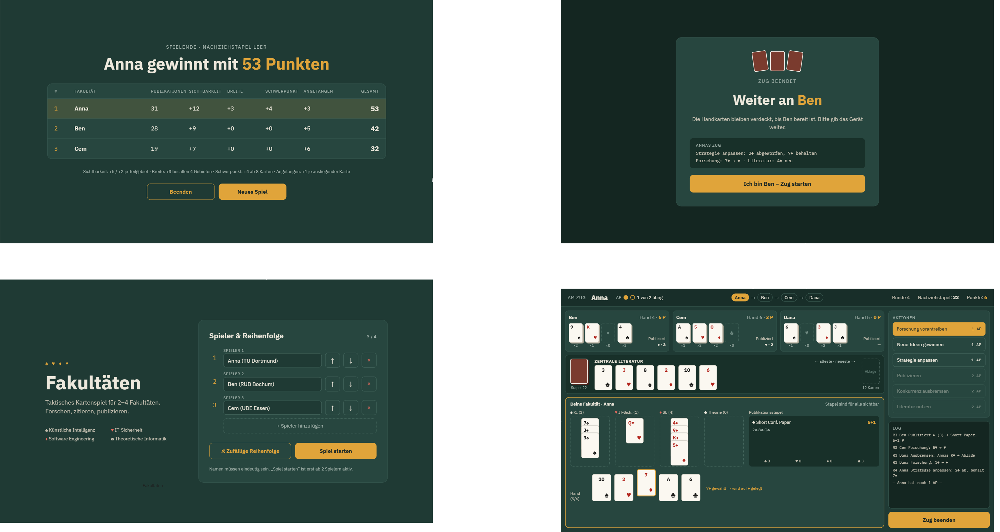

# Exzellente Informatik-Forschung – Kotlin Card Game

A digital, rule-enforcing implementation of a tactical card game for 2–4 players, built with **Kotlin** and the **BoardGameWork (BGW)** GUI framework.

Team project from the **Softwarepraktikum (SoPra), TU Dortmund** – developed in a student team using Scrum (sprints, user stories, merge requests with code review, CI pipeline).



## The game
Each player leads a computer science faculty competing for the best research output.
The four card suits stand for four research areas (AI, IT security, software engineering, theoretical CS).
With 2 action points per turn, players advance research, draw new ideas, adapt their strategy,
cite literature from a shared display, slow down competitors – and decide **when to publish**.
Publishing a stack earns points (poster → journal article), and the final scoring adds bonuses for
visibility, breadth and research focus.

Full rules (German): [`docs/moodle/moodle-info.md`](docs/moodle/moodle-info.md)

## Features
- 2–4 players, names configurable, turn order set manually or randomized
- **Hotseat mode**: players take turns on the same screen; hand cards stay hidden until the next player confirms
- All game rules are enforced by the service layer (action points, hand limit, publishing, end of game)
- Action log that summarizes every player action in readable form
- Final score table with bonus breakdown and winner

## Architecture
Layered architecture with a strict separation of game state, logic and UI:

```
src/main/kotlin
├── entity/    game state – FacultyGame, Faculty, ResearchCard, ResearchArea, …
├── service/   game logic – RootService, GameService, PlayerActionService
└── gui/       BGW scenes – StartMenuScene, HotseatScene, GameScene, EndgameMenuScene
```

The GUI is updated via the **observer pattern**: services notify all registered `Refreshable`s
(`onAllRefreshables { … }`), and the scenes update themselves in response.

Design documents (class diagrams, activity diagrams, use cases) are in [`docs/`](docs).

## Quality
- **98 unit tests** (JUnit 5) for the entity and service layers, covering success and error cases of every player action plus a full-game test
- Static analysis with **detekt**, KDoc for public classes and methods
- GitLab CI pipeline: build → test → analysis

## Tech stack
Kotlin 2.3 · JVM 11 · BoardGameWork 0.11 · Gradle · JUnit 5 · detekt · GitLab CI

## Running the game
**Easiest:** download `projekt1-distribution.zip` from the [Releases](../../releases) page, unzip it and run

```bash
./bin/projekt1        # Linux / macOS
bin\projekt1.bat      # Windows
```

Requires Java 11 or newer.

**Building from source:** the build uses the SoPra Gradle plugin from the TU Dortmund package registry,
so a SoPra GitLab access token has to be set in `gradle.properties`. Then:

```bash
./gradlew run     # start the game
./gradlew test    # run the tests
```

## Team
Developed by SoPra group 07 at TU Dortmund. Team rules and workflow: [`CONTRIBUTING.md`](CONTRIBUTING.md)

Repository maintained by Aziz Dardouri.
