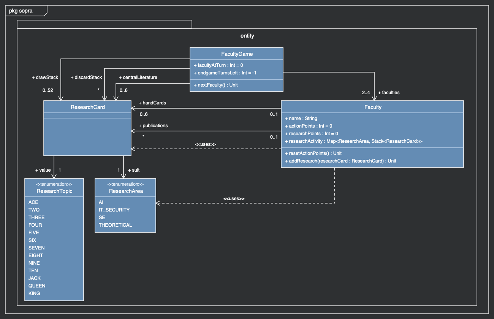
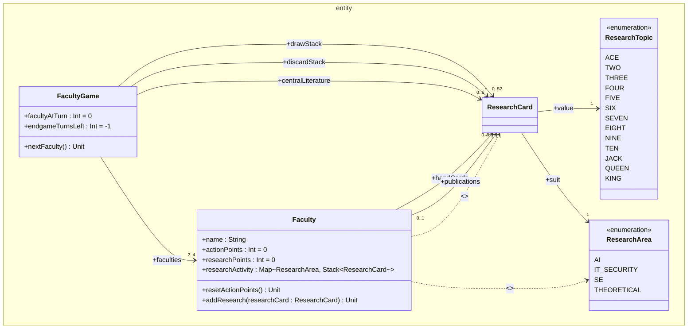
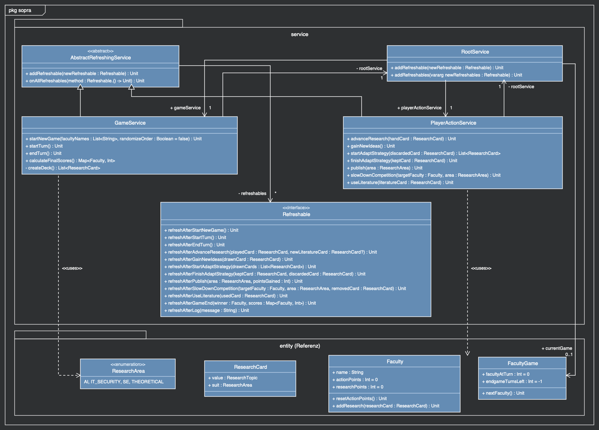
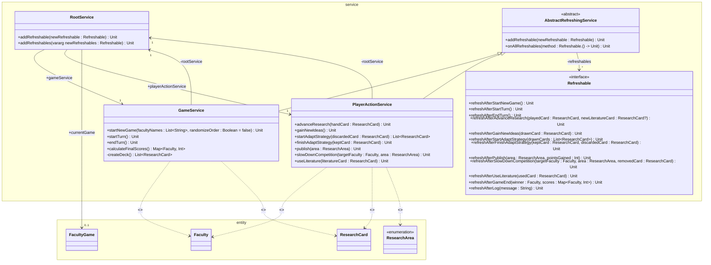
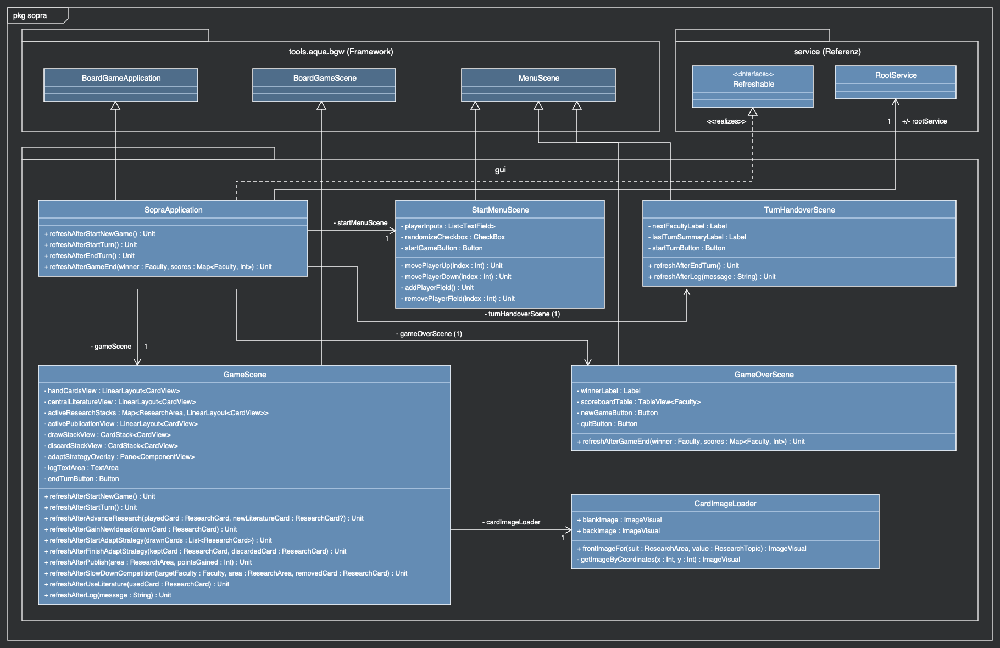
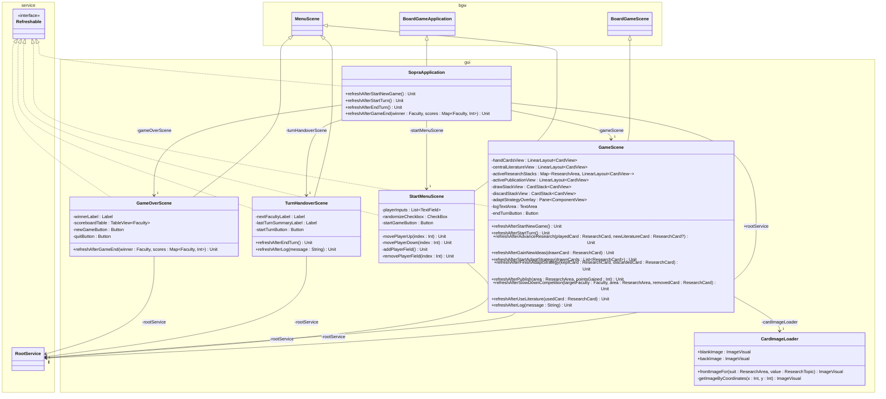
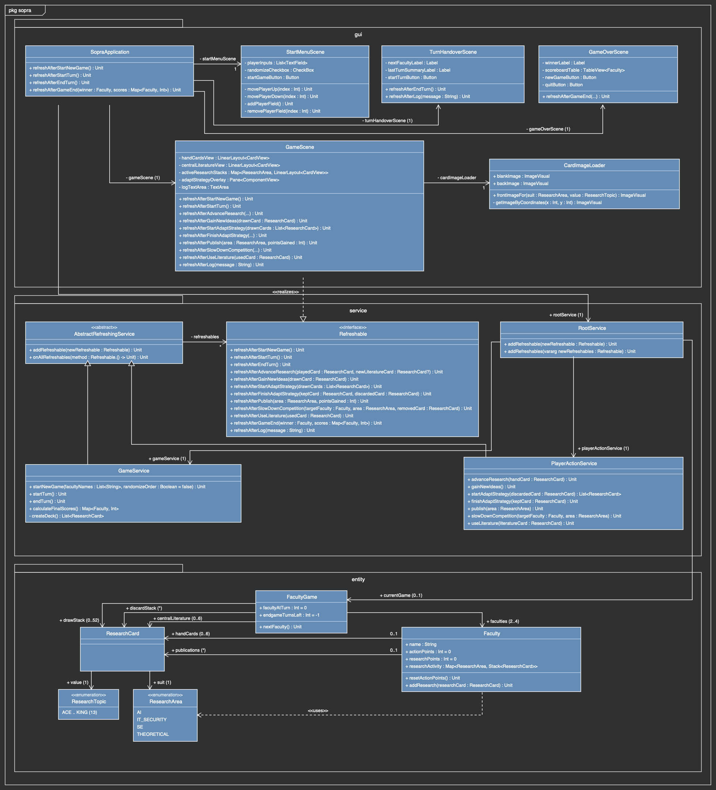

# Klassendiagramme & Service-Schicht API-Dokumentation

Dieses Dokument enthält für das Spiel **Fakultäten – Exzellente Informatik-Forschung** (`sopra`):

1. **Klassendiagramme** (als gerenderte `.png`-Dateien sowie als **Mermaid `classDiagram`**):
   - [1.1 Entity-Schicht (`entity`)](#11-entity-schicht-entity)
   - [1.2 Service-Schicht (`service`)](#12-service-schicht-service)
   - [1.3 GUI-Schicht (`gui`)](#13-gui-schicht-gui)
   - [1.4 Gesamtanwendung (`entity` + `service` + `gui`)](#14-gesamtanwendung-entity--service--gui)
2. **Vollständige API-Dokumentation der Service-Schicht** (Spezifikation aller Klassen, Methoden, Vorbedingungen, Fehlerfälle, Nachbedingungen und `Refreshable`-Callbacks):
   - [2.1 `RootService`](#21-rootservice)
   - [2.2 `AbstractRefreshingService`](#22-abstractrefreshingservice)
   - [2.3 `GameService`](#23-gameservice)
   - [2.4 `PlayerActionService`](#24-playeractionservice)
   - [2.5 `Refreshable`](#25-refreshable)
3. **Astah-Spezifikation (Übersichtstabellen zum Übertragen in Astah UML)**:
   - [3.1 Klassen, Attribute und Methoden](#31-klassen-attribute-und-methoden)
   - [3.2 Assoziationen, Vererbungen und Abhängigkeiten](#32-assoziationen-vererbungen-und-abhängigkeiten)

---

## 1. Klassendiagramme

### 1.1 Entity-Schicht (`entity`)

---

### 1.2 Service-Schicht (`service`)

---

### 1.3 GUI-Schicht (`gui`)

---

### 1.4 Gesamtanwendung (`entity` + `service` + `gui`)

```mermaid
classDiagram
    namespace gui {
        class SopraApplication {
            +refreshAfterStartNewGame() Unit
            +refreshAfterStartTurn() Unit
            +refreshAfterEndTurn() Unit
            +refreshAfterGameEnd(winner : Faculty, scores : Map~Faculty, Int~) Unit
        }
        class StartMenuScene {
            -playerInputs : List~TextField~
            -randomizeCheckbox : CheckBox
            -startGameButton : Button
            -movePlayerUp(index : Int) Unit
            -movePlayerDown(index : Int) Unit
            -addPlayerField() Unit
            -removePlayerField(index : Int) Unit
        }
        class GameScene {
            -handCardsView : LinearLayout~CardView~
            -centralLiteratureView : LinearLayout~CardView~
            -activeResearchStacks : Map~ResearchArea, LinearLayout~CardView~~
            -adaptStrategyOverlay : Pane~ComponentView~
            -logTextArea : TextArea
            +refreshAfterStartNewGame() Unit
            +refreshAfterStartTurn() Unit
            +refreshAfterAdvanceResearch(playedCard : ResearchCard, newLiteratureCard : ResearchCard?) Unit
            +refreshAfterGainNewIdeas(drawnCard : ResearchCard) Unit
            +refreshAfterStartAdaptStrategy(drawnCards : List~ResearchCard~) Unit
            +refreshAfterFinishAdaptStrategy(keptCard : ResearchCard, discardedCard : ResearchCard) Unit
            +refreshAfterPublish(area : ResearchArea, pointsGained : Int) Unit
            +refreshAfterSlowDownCompetition(targetFaculty : Faculty, area : ResearchArea, removedCard : ResearchCard) Unit
            +refreshAfterUseLiterature(usedCard : ResearchCard) Unit
            +refreshAfterLog(message : String) Unit
        }
        class TurnHandoverScene {
            -nextFacultyLabel : Label
            -lastTurnSummaryLabel : Label
            -startTurnButton : Button
            +refreshAfterEndTurn() Unit
            +refreshAfterLog(message : String) Unit
        }
        class GameOverScene {
            -winnerLabel : Label
            -scoreboardTable : TableView~Faculty~
            -newGameButton : Button
            -quitButton : Button
            +refreshAfterGameEnd(winner : Faculty, scores : Map~Faculty, Int~) Unit
        }
        class CardImageLoader {
            +blankImage : ImageVisual
            +backImage : ImageVisual
            +frontImageFor(suit : ResearchArea, value : ResearchTopic) ImageVisual
            -getImageByCoordinates(x : Int, y : Int) ImageVisual
        }
    }

    namespace service {
        class RootService {
            +addRefreshable(newRefreshable : Refreshable) Unit
            +addRefreshables(vararg newRefreshables : Refreshable) Unit
        }
        class AbstractRefreshingService {
            <<abstract>>
            +addRefreshable(newRefreshable : Refreshable) Unit
            +onAllRefreshables(method : Refreshable.() -> Unit) Unit
        }
        class GameService {
            +startNewGame(facultyNames : List~String~, randomizeOrder : Boolean = false) Unit
            +startTurn() Unit
            +endTurn() Unit
            +calculateFinalScores() Map~Faculty, Int~
            -createDeck() List~ResearchCard~
        }
        class PlayerActionService {
            +advanceResearch(handCard : ResearchCard) Unit
            +gainNewIdeas() Unit
            +startAdaptStrategy(discardedCard : ResearchCard) List~ResearchCard~
            +finishAdaptStrategy(keptCard : ResearchCard) Unit
            +publish(area : ResearchArea) Unit
            +slowDownCompetition(targetFaculty : Faculty, area : ResearchArea) Unit
            +useLiterature(literatureCard : ResearchCard) Unit
        }
        class Refreshable {
            <<interface>>
            +refreshAfterStartNewGame() Unit
            +refreshAfterStartTurn() Unit
            +refreshAfterEndTurn() Unit
            +refreshAfterAdvanceResearch(playedCard : ResearchCard, newLiteratureCard : ResearchCard?) Unit
            +refreshAfterGainNewIdeas(drawnCard : ResearchCard) Unit
            +refreshAfterStartAdaptStrategy(drawnCards : List~ResearchCard~) Unit
            +refreshAfterFinishAdaptStrategy(keptCard : ResearchCard, discardedCard : ResearchCard) Unit
            +refreshAfterPublish(area : ResearchArea, pointsGained : Int) Unit
            +refreshAfterSlowDownCompetition(targetFaculty : Faculty, area : ResearchArea, removedCard : ResearchCard) Unit
            +refreshAfterUseLiterature(usedCard : ResearchCard) Unit
            +refreshAfterGameEnd(winner : Faculty, scores : Map~Faculty, Int~) Unit
            +refreshAfterLog(message : String) Unit
        }
    }

    namespace entity {
        class FacultyGame {
            +facultyAtTurn : Int = 0
            +endgameTurnsLeft : Int = -1
            +nextFaculty() Unit
        }
        class Faculty {
            +name : String
            +actionPoints : Int = 0
            +researchPoints : Int = 0
            +researchActivity : Map~ResearchArea, Stack~ResearchCard~~
            +resetActionPoints() Unit
            +addResearch(researchCard : ResearchCard) Unit
        }
        class ResearchCard {
        }
        class ResearchTopic {
            <<enumeration>>
            ACE .. KING
        }
        class ResearchArea {
            <<enumeration>>
            AI
            IT_SECURITY
            SE
            THEORETICAL
        }
    }

    SopraApplication --> "1" StartMenuScene : -startMenuScene
    SopraApplication --> "1" GameScene : -gameScene
    SopraApplication --> "1" TurnHandoverScene : -turnHandoverScene
    SopraApplication --> "1" GameOverScene : -gameOverScene
    GameScene --> "1" CardImageLoader : -cardImageLoader

    Refreshable <|.. SopraApplication
    Refreshable <|.. StartMenuScene
    Refreshable <|.. GameScene
    Refreshable <|.. TurnHandoverScene
    Refreshable <|.. GameOverScene
    SopraApplication --> "1" RootService : +rootService

    AbstractRefreshingService <|-- GameService
    AbstractRefreshingService <|-- PlayerActionService
    AbstractRefreshingService --> "*" Refreshable : -refreshables
    RootService --> "1" GameService : +gameService
    RootService --> "1" PlayerActionService : +playerActionService
    RootService --> "0..1" FacultyGame : +currentGame

    FacultyGame --> "0..52" ResearchCard : +drawStack
    FacultyGame --> "*" ResearchCard : +discardStack
    FacultyGame --> "0..6" ResearchCard : +centralLiterature
    FacultyGame --> "2..4" Faculty : +faculties
    Faculty "0..1" --> "0..6" ResearchCard : +handCards
    Faculty "0..1" --> "*" ResearchCard : +publications
    ResearchCard --> "1" ResearchTopic : +value
    ResearchCard --> "1" ResearchArea : +suit
```

---

## 2. Vollständige API-Dokumentation der Service-Schicht

Gemäß den Architektur-Regeln (siehe `CONTRIBUTING.md`) ist die gesamte Service-Schicht **stateless**. Der einzige Spielzustand liegt in `RootService.currentGame`. Jede Service-Methode arbeitet in drei Schritten:

1. **Vorbedingungen & Eingaben prüfen** (`IllegalStateException` bei ungültigem Spielzustand/AP, `IllegalArgumentException` bei ungültigen Parametern).
2. **Spiellogik auf dem Entity-Modell ausführen**.
3. **UI-Refreshes & Log über `onAllRefreshables { ... }` auslösen**.

---

### 2.1 `RootService`

Zentrale Verwaltungsklasse der Service-Schicht. Verbindet `GameService` und `PlayerActionService` und hält die Referenz auf das aktuell laufende `FacultyGame`.

#### Eigenschaften (Associations)
- `val gameService: GameService = GameService(this)` — Instanz des Spielverwaltungs-Service.
- `val playerActionService: PlayerActionService = PlayerActionService(this)` — Instanz des Aktions-Service.
- `var currentGame: FacultyGame? = null` — Das aktuell laufende Spiel (`null`, falls kein Spiel aktiv ist).

#### Methoden
- **`addRefreshable(newRefreshable: Refreshable): Unit`**
  - Registriert ein `Refreshable` sowohl beim `gameService` als auch beim `playerActionService`.
- **`addRefreshables(vararg newRefreshables: Refreshable): Unit`**
  - Registriert mehrere `Refreshable`-Instanzen auf einmal bei allen Sub-Services.

---

### 2.2 `AbstractRefreshingService`

Abstrakte Basisklasse für `GameService` und `PlayerActionService` zur Benachrichtigung registrierter `Refreshable`-Objekte (in der Regel GUI-Szenen und Test-Refreshables).

#### Eigenschaften
- `private val refreshables: MutableList<Refreshable> = mutableListOf()`

#### Methoden
- **`addRefreshable(newRefreshable: Refreshable): Unit`**
  - Fügt ein neues `Refreshable` zur Benachrichtigungsliste hinzu.
- **`onAllRefreshables(method: Refreshable.() -> Unit): Unit`**
  - Führt die übergebene Callback-Funktion auf allen registrierten `Refreshable`-Instanzen aus.

---

### 2.3 `GameService`

Verantwortlich für Spielstart, Deck-Erstellung, Zugwechsel, Spielende-Erkennung und die abschließende Punktewertung.

#### Konstruktor / Eigenschaften
- `class GameService(private val rootService: RootService) : AbstractRefreshingService()`

---

#### `startNewGame(facultyNames: List<String>, randomizeOrder: Boolean = false): Unit`

Initialisiert und startet eine neue Partie *Fakultäten*.

| Parameter | Typ | Gültige Werte |
|---|---|---|
| `facultyNames` | `List<String>` | 2 bis 4 nicht-leere, eindeutige Namen |
| `randomizeOrder` | `Boolean` | `true` (Reihenfolge zufällig mischen) oder `false` (Reihenfolge beibehalten) |

**Vorbedingungen → Fehlerfall:**
| Vorbedingung | Exception |
|---|---|
| `facultyNames.size in 2..4` | `IllegalArgumentException` |
| Alle Namen sind nicht leer (`isNotBlank()`) | `IllegalArgumentException` |
| Alle Namen sind eindeutig (`distinct().size == size`) | `IllegalArgumentException` |

**Verhalten (Nachbedingungen):**
1. Erstellt aus `facultyNames` (ggf. gemischt bei `randomizeOrder == true`) die `Faculty`-Objekte und initialisiert `rootService.currentGame = FacultyGame(faculties)`.
2. Erzeugt ein gemischtes 52-Karten-Standarddeck (`createDeck()`) und legt es auf `drawStack`.
3. Teilt jeder Fakultät **5 Handkarten** (`handCards`) vom `drawStack` aus.
4. Legt **6 Karten** vom `drawStack` offen in `centralLiterature` (Index 0 = älteste Karte, letzter Index = neueste Karte).
5. Setzt die Aktionspunkte der ersten Fakultät (`faculties[0]`) via `resetActionPoints()` auf **2 AP**.
6. Löst `onAllRefreshables { refreshAfterStartNewGame(); refreshAfterLog(...) }` aus.

---

#### `startTurn(): Unit`

Startet den Zug der aktuell aktiven Fakultät (wird z.B. nach Bestätigung des Hotseat-Übergabebildschirms aufgerufen).

**Vorbedingungen → Fehlerfall:**
| Vorbedingung | Exception |
|---|---|
| `rootService.currentGame != null` | `IllegalStateException` |

**Verhalten (Nachbedingungen):**
1. Setzt die Aktionspunkte der aktiven Fakultät (`faculties[facultyAtTurn]`) mittels `resetActionPoints()` auf `2`.
2. Löst `onAllRefreshables { refreshAfterStartTurn() }` aus.

---

#### `endTurn(): Unit`

Beendet den Zug der aktiven Fakultät, prüft die Endspiel-Bedingung (leerer Nachziehstapel) und wechselt zur nächsten Fakultät oder beendet das Spiel.

**Vorbedingungen → Fehlerfall:**
| Vorbedingung | Exception |
|---|---|
| `rootService.currentGame != null` | `IllegalStateException` |

**Verhalten (Nachbedingungen):**
1. Falls `drawStack.isEmpty()` und `endgameTurnsLeft == -1`:
   - Startet den Endspiel-Countdown: `endgameTurnsLeft = faculties.size - 1` (jede andere Fakultät kommt noch genau einmal dran).
2. Else falls `endgameTurnsLeft > 0`:
   - Dekrementiert `endgameTurnsLeft--`.
3. Falls `endgameTurnsLeft == 0`:
   - Das Spiel ist beendet: Berechnet die Endwertung via `calculateFinalScores()`, ermittelt die Gewinner-Fakultät und löst `onAllRefreshables { refreshAfterGameEnd(winner, scores); refreshAfterLog(...) }` aus.
4. Andernfalls (Spiel läuft weiter):
   - Ruft `game.nextFaculty()` auf und setzt die AP der neuen aktiven Fakultät auf `2` (`resetActionPoints()`).
   - Löst `onAllRefreshables { refreshAfterEndTurn(); refreshAfterLog(...) }` aus.

---

#### `calculateFinalScores(): Map<Faculty, Int>`

Berechnet die Gesamtpunktzahl aller Fakultäten bei Spielende (laufende Publikationspunkte + 4 Abschluss-Boni).

**Vorbedingungen → Fehlerfall:**
| Vorbedingung | Exception |
|---|---|
| `rootService.currentGame != null` | `IllegalStateException` |

**Berechnungsregeln:**
Zu den bereits während des Spiels durch Publikationen gesammelten `faculty.researchPoints` werden folgende Bonuspunkte addiert:
1. **Sichtbarkeit (Mehrheiten)** – pro `ResearchArea` (es zählen nur Karten in `faculty.publications`):
   - Meiste publizierte Karten im Teilgebiet (falls $> 0$): **+5 Punkte**
   - Zweitmeiste publizierte Karten im Teilgebiet (falls $> 0$): **+2 Punkte**
2. **Breite Aufstellung**:
   - Mindestens 1 Karte aus allen 4 `ResearchArea`s in `faculty.publications`: **+3 Punkte**
3. **Forschungsschwerpunkt**:
   - Pro `ResearchArea`, in der eine Fakultät $\ge 8$ Karten in `faculty.publications` hat: **+4 Punkte**
4. **Angefangene Forschung**:
   - Jede ausliegende Karte in `faculty.researchActivity` (alle 4 Stapel summiert): **+1 Punkt**

---

#### `private createDeck(): List<ResearchCard>`

Erstellt alle 52 Karten (4 `ResearchArea` $\times$ 13 `ResearchTopic`) und gibt sie gemischt zurück.

---

### 2.4 `PlayerActionService`

Implementiert die 6 Spielaktionen der aktiven Fakultät.

#### Konstruktor / Eigenschaften
- `class PlayerActionService(private val rootService: RootService) : AbstractRefreshingService()`

---

#### 1. `advanceResearch(handCard: ResearchCard): Unit` — *Forschung vorantreiben (1 AP)*

Spielt eine Handkarte in den passenden eigenen Forschungsstapel und legt 1 Karte vom Nachziehstapel in die zentrale Literatur.

| Parameter | Typ | Gültige Werte |
|---|---|---|
| `handCard` | `ResearchCard` | Muss sich in `activeFaculty.handCards` befinden |

**Vorbedingungen → Fehlerfall:**
| Vorbedingung | Exception |
|---|---|
| Ein Spiel läuft (`currentGame != null`) | `IllegalStateException` |
| `activeFaculty.actionPoints >= 1` | `IllegalStateException` |
| `handCard in activeFaculty.handCards` | `IllegalArgumentException` |

**Verhalten (Nachbedingungen):**
1. Entfernt `handCard` aus `activeFaculty.handCards` und legt sie mit `activeFaculty.addResearch(handCard)` auf den passenden Stapel `researchActivity[handCard.suit]`.
2. Falls `drawStack.isNotEmpty()`:
   - Falls `centralLiterature.size == 6`, wird die älteste Karte (`centralLiterature.removeAt(0)`) entfernt und auf `discardStack` gelegt.
   - Zieht die oberste Karte von `drawStack` (`drawStack.pop()`) und fügt sie ans Ende von `centralLiterature` an.
3. Reduziert `activeFaculty.actionPoints` um **1**.
4. Löst `onAllRefreshables { refreshAfterAdvanceResearch(handCard, newLiteratureCard); refreshAfterLog(...) }` aus.

---

#### 2. `gainNewIdeas(): Unit` — *Neue Ideen gewinnen (1 AP)*

Zieht 1 Karte vom Nachziehstapel auf die Hand der aktiven Fakultät.

**Vorbedingungen → Fehlerfall:**
| Vorbedingung | Exception |
|---|---|
| Ein Spiel läuft (`currentGame != null`) | `IllegalStateException` |
| `activeFaculty.actionPoints >= 1` | `IllegalStateException` |
| `activeFaculty.handCards.size <= 5` (Handkartenlimit: 6) | `IllegalStateException` |
| `drawStack.isNotEmpty()` | `IllegalStateException` |

**Verhalten (Nachbedingungen):**
1. Entfernt die oberste Karte vom `drawStack` (`drawStack.pop()`) und fügt sie zu `activeFaculty.handCards` hinzu.
2. Reduziert `activeFaculty.actionPoints` um **1**.
3. Löst `onAllRefreshables { refreshAfterGainNewIdeas(drawnCard); refreshAfterLog(...) }` aus.

---

#### 3a. `startAdaptStrategy(discardedCard: ResearchCard): List<ResearchCard>` — *Strategie anpassen – Schritt 1 (1 AP)*

Wirft 1 Handkarte ab und deckt die obersten 2 Karten des Nachziehstapels zur Auswahl auf.

| Parameter | Typ | Gültige Werte |
|---|---|---|
| `discardedCard` | `ResearchCard` | Muss sich in `activeFaculty.handCards` befinden |

**Vorbedingungen → Fehlerfall:**
| Vorbedingung | Exception |
|---|---|
| Ein Spiel läuft (`currentGame != null`) | `IllegalStateException` |
| `activeFaculty.actionPoints >= 1` | `IllegalStateException` |
| `drawStack.size >= 2` | `IllegalStateException` |
| `discardedCard in activeFaculty.handCards` | `IllegalArgumentException` |

**Verhalten (Nachbedingungen):**
1. Entfernt `discardedCard` aus `activeFaculty.handCards` und legt sie auf `discardStack`.
2. Reduziert `activeFaculty.actionPoints` um **1**.
3. Liest die obersten 2 Karten vom `drawStack` (bleiben bis `finishAdaptStrategy` oben auf `drawStack`, sodass der Service komplett **stateless** bleibt).
4. Löst `onAllRefreshables { refreshAfterStartAdaptStrategy(drawnCards) }` aus und gibt die 2 Karten als `List<ResearchCard>` zurück.

---

#### 3b. `finishAdaptStrategy(keptCard: ResearchCard): Unit` — *Strategie anpassen – Schritt 2*

Nimmt die ausgewählte der 2 gezogenen Karten auf die Hand und wirft die andere auf den Ablagestapel.

| Parameter | Typ | Gültige Werte |
|---|---|---|
| `keptCard` | `ResearchCard` | Eine der beiden in `startAdaptStrategy` aufgedeckten obersten Karten von `drawStack` |

**Vorbedingungen → Fehlerfall:**
| Vorbedingung | Exception |
|---|---|
| Ein Spiel läuft (`currentGame != null`) | `IllegalStateException` |
| `drawStack.size >= 2` | `IllegalStateException` |
| `keptCard` ist eine der beiden obersten Karten von `drawStack` | `IllegalArgumentException` |

**Verhalten (Nachbedingungen):**
1. Entnimmt die beiden obersten Karten vom `drawStack`.
2. Fügt `keptCard` zu `activeFaculty.handCards` hinzu.
3. Legt die nicht gewählte Karte auf `discardStack`.
4. Löst `onAllRefreshables { refreshAfterFinishAdaptStrategy(keptCard, otherCard); refreshAfterLog(...) }` aus.

---

#### 4. `publish(area: ResearchArea): Unit` — *Publizieren (2 AP)*

Publiziert alle Karten eines eigenen Forschungsstapels im gewählten Teilgebiet `area`.

| Parameter | Typ | Gültige Werte |
|---|---|---|
| `area` | `ResearchArea` | Teilgebiet, in dem die aktive Fakultät $\ge 2$ Karten liegen hat |

**Vorbedingungen → Fehlerfall:**
| Vorbedingung | Exception |
|---|---|
| Ein Spiel läuft (`currentGame != null`) | `IllegalStateException` |
| `activeFaculty.actionPoints >= 2` | `IllegalStateException` |
| `activeFaculty.researchActivity.getValue(area).size >= 2` | `IllegalArgumentException` |

**Verhalten (Nachbedingungen):**
1. Prüft vor dem Verschieben, ob bereits irgendeine Fakultät (`game.faculties`) eine Karte mit `suit == area` in `publications` hat (`isFirstInArea`).
2. Berechnet die Punkte anhand der Kartenanzahl $n$ des Stapels `activeFaculty.researchActivity.getValue(area)`:
   - $n = 2 \rightarrow 3\text{ Punkte}$ (Poster-Präsentation)
   - $n = 3 \rightarrow 5\text{ Punkte}$ (Short Conference Paper)
   - $n = 4 \rightarrow 7\text{ Punkte}$ (Regular Conference Paper)
   - $n \ge 5 \rightarrow 9\text{ Punkte}$ (Journal-Artikel)
   - Falls `isFirstInArea == true`: **+1 Zusatzpunkt**.
3. Verschiebt alle Karten aus `activeFaculty.researchActivity.getValue(area)` in `activeFaculty.publications`.
4. Addiert die erzielten Punkte auf `activeFaculty.researchPoints`.
5. Reduziert `activeFaculty.actionPoints` um **2**.
6. Löst `onAllRefreshables { refreshAfterPublish(area, pointsGained); refreshAfterLog(...) }` aus.

---

#### 5. `slowDownCompetition(targetFaculty: Faculty, area: ResearchArea): Unit` — *Konkurrenz ausbremsen (2 AP)*

Entfernt die oberste Karte eines Forschungsstapels einer anderen Fakultät und legt sie auf den Ablagestapel.

| Parameter | Typ | Gültige Werte |
|---|---|---|
| `targetFaculty` | `Faculty` | Eine andere Fakultät (`targetFaculty != activeFaculty` und `targetFaculty in game.faculties`) |
| `area` | `ResearchArea` | Teilgebiet, in dem `targetFaculty` mindestens 1 Karte liegen hat |

**Vorbedingungen → Fehlerfall:**
| Vorbedingung | Exception |
|---|---|
| Ein Spiel läuft (`currentGame != null`) | `IllegalStateException` |
| `activeFaculty.actionPoints >= 2` | `IllegalStateException` |
| `targetFaculty in game.faculties && targetFaculty != activeFaculty` | `IllegalArgumentException` |
| `targetFaculty.researchActivity.getValue(area).isNotEmpty()` | `IllegalArgumentException` |

**Verhalten (Nachbedingungen):**
1. Entfernt die oberste Karte von `targetFaculty.researchActivity.getValue(area)` (`pop()`) und legt sie auf `game.discardStack` (`push()`).
2. Reduziert `activeFaculty.actionPoints` um **2**.
3. Löst `onAllRefreshables { refreshAfterSlowDownCompetition(targetFaculty, area, removedCard); refreshAfterLog(...) }` aus.

---

#### 6. `useLiterature(literatureCard: ResearchCard): Unit` — *Literatur nutzen (2 AP)*

Nimmt eine beliebige Karte aus der zentralen Literatur und legt sie offen auf den passenden eigenen Forschungsstapel.

| Parameter | Typ | Gültige Werte |
|---|---|---|
| `literatureCard` | `ResearchCard` | Muss sich in `game.centralLiterature` befinden |

**Vorbedingungen → Fehlerfall:**
| Vorbedingung | Exception |
|---|---|
| Ein Spiel läuft (`currentGame != null`) | `IllegalStateException` |
| `activeFaculty.actionPoints >= 2` | `IllegalStateException` |
| `literatureCard in game.centralLiterature` | `IllegalArgumentException` |

**Verhalten (Nachbedingungen):**
1. Entfernt `literatureCard` aus `game.centralLiterature` (die übrigen Karten rücken in der Liste automatisch zusammen).
2. Legt `literatureCard` mittels `activeFaculty.addResearch(literatureCard)` auf den eigenen Stapel `researchActivity[literatureCard.suit]`.
3. Reduziert `activeFaculty.actionPoints` um **2**.
4. Löst `onAllRefreshables { refreshAfterUseLiterature(literatureCard); refreshAfterLog(...) }` aus.

---

### 2.5 `Refreshable`

Interface für die Kommunikation von der Service-Schicht zur GUI-Schicht (sowie für Unit-Tests). Alle Methoden besitzen eine leere Default-Implementierung (`{}`).

| Methode | Ausgelöst durch | Beschreibung |
|---|---|---|
| `refreshAfterStartNewGame()` | `GameService.startNewGame` | Initialisiert das Spielfeld nach Spielstart |
| `refreshAfterStartTurn()` | `GameService.startTurn` | Aktualisiert die Ansicht zu Beginn eines Zuges |
| `refreshAfterEndTurn()` | `GameService.endTurn` | Zeigt den Hotseat-Übergabebildschirm (`TurnHandoverScene`) für die nächste Fakultät |
| `refreshAfterAdvanceResearch(playedCard: ResearchCard, newLiteratureCard: ResearchCard?)` | `PlayerActionService.advanceResearch` | Aktualisiert Handkarten, Forschungsstapel und zentrale Literatur |
| `refreshAfterGainNewIdeas(drawnCard: ResearchCard)` | `PlayerActionService.gainNewIdeas` | Aktualisiert Handkarten und Nachziehstapel |
| `refreshAfterStartAdaptStrategy(drawnCards: List<ResearchCard>)` | `PlayerActionService.startAdaptStrategy` | Zeigt das Auswahl-Overlay mit den 2 gezogenen Karten |
| `refreshAfterFinishAdaptStrategy(keptCard: ResearchCard, discardedCard: ResearchCard)` | `PlayerActionService.finishAdaptStrategy` | Schließt das Auswahl-Overlay und aktualisiert Handkarten & Ablagestapel |
| `refreshAfterPublish(area: ResearchArea, pointsGained: Int)` | `PlayerActionService.publish` | Aktualisiert Forschungsstapel, Publikationsstapel und Punkteanzeige |
| `refreshAfterSlowDownCompetition(targetFaculty: Faculty, area: ResearchArea, removedCard: ResearchCard)` | `PlayerActionService.slowDownCompetition` | Aktualisiert den gegnerischen Forschungsstapel und den Ablagestapel |
| `refreshAfterUseLiterature(usedCard: ResearchCard)` | `PlayerActionService.useLiterature` | Aktualisiert die zentrale Literatur und den eigenen Forschungsstapel |
| `refreshAfterGameEnd(winner: Faculty, scores: Map<Faculty, Int>)` | `GameService.endTurn` | Wechselt zur `GameOverScene` und zeigt die Endabrechnung |
| `refreshAfterLog(message: String)` | Alle Aktionen / Zugwechsel | Fügt eine menschenlesbare Zeile zum Aktions-Log (GUI & Konsole) hinzu |

---

## 3. Astah-Spezifikation (Übersichtstabellen zum Übertragen in Astah UML)

### 3.1 Klassen, Attribute und Methoden

| Paket | Klasse / Typ | Stereotyp | Attribute (Sichtbarkeit, Name, Typ, Default) | Methoden (Sichtbarkeit, Signatur, Rückgabetyp) |
|---|---|---|---|---|
| `entity` | `FacultyGame` | – | `+ facultyAtTurn : Int = 0` `+ endgameTurnsLeft : Int = -1` | `+ nextFaculty() : Unit` |
| `entity` | `Faculty` | – | `+ name : String` `+ actionPoints : Int = 0` `+ researchPoints : Int = 0` `+ researchActivity : Map<ResearchArea, Stack<ResearchCard>>` | `+ resetActionPoints() : Unit` `+ addResearch(researchCard : ResearchCard) : Unit` |
| `entity` | `ResearchCard` | – | *(über Assoziationen `+ value` und `+ suit` modelliert)* | – |
| `entity` | `ResearchTopic` | `<<enumeration>>` | `ACE, TWO, THREE, FOUR, FIVE, SIX, SEVEN, EIGHT, NINE, TEN, JACK, QUEEN, KING` | – |
| `entity` | `ResearchArea` | `<<enumeration>>` | `AI, IT_SECURITY, SE, THEORETICAL` | – |
| `service` | `RootService` | – | – | `+ addRefreshable(newRefreshable : Refreshable) : Unit` `+ addRefreshables(vararg newRefreshables : Refreshable) : Unit` |
| `service` | `AbstractRefreshingService` | `<<abstract>>` | – | `+ addRefreshable(newRefreshable : Refreshable) : Unit` `+ onAllRefreshables(method : Refreshable.() -> Unit) : Unit` |
| `service` | `GameService` | – | – | `+ startNewGame(facultyNames : List<String>, randomizeOrder : Boolean = false) : Unit` `+ startTurn() : Unit` `+ endTurn() : Unit` `+ calculateFinalScores() : Map<Faculty, Int>` `- createDeck() : List<ResearchCard>` |
| `service` | `PlayerActionService` | – | – | `+ advanceResearch(handCard : ResearchCard) : Unit` `+ gainNewIdeas() : Unit` `+ startAdaptStrategy(discardedCard : ResearchCard) : List<ResearchCard>` `+ finishAdaptStrategy(keptCard : ResearchCard) : Unit` `+ publish(area : ResearchArea) : Unit` `+ slowDownCompetition(targetFaculty : Faculty, area : ResearchArea) : Unit` `+ useLiterature(literatureCard : ResearchCard) : Unit` |
| `service` | `Refreshable` | `<<interface>>` | – | Alle 12 `refreshAfter...`-Methoden (siehe Abschnitt 2.5) |
| `gui` | `SopraApplication` | – | – | `+ refreshAfterStartNewGame() : Unit` `+ refreshAfterStartTurn() : Unit` `+ refreshAfterEndTurn() : Unit` `+ refreshAfterGameEnd(winner : Faculty, scores : Map<Faculty, Int>) : Unit` |
| `gui` | `StartMenuScene` | – | `- playerInputs : List<TextField>` `- randomizeCheckbox : CheckBox` `- startGameButton : Button` | `- movePlayerUp(index : Int) : Unit` `- movePlayerDown(index : Int) : Unit` `- addPlayerField() : Unit` `- removePlayerField(index : Int) : Unit` |
| `gui` | `GameScene` | – | `- handCardsView : LinearLayout<CardView>` `- centralLiteratureView : LinearLayout<CardView>` `- activeResearchStacks : Map<ResearchArea, LinearLayout<CardView>>` `- activePublicationView : LinearLayout<CardView>` `- drawStackView : CardStack<CardView>` `- discardStackView : CardStack<CardView>` `- adaptStrategyOverlay : Pane<ComponentView>` `- logTextArea : TextArea` `- endTurnButton : Button` | Relevante `refreshAfter...`-Methoden aus `Refreshable` |
| `gui` | `TurnHandoverScene` | – | `- nextFacultyLabel : Label` `- lastTurnSummaryLabel : Label` `- startTurnButton : Button` | `+ refreshAfterEndTurn() : Unit` `+ refreshAfterLog(message : String) : Unit` |
| `gui` | `GameOverScene` | – | `- winnerLabel : Label` `- scoreboardTable : TableView<Faculty>` `- newGameButton : Button` `- quitButton : Button` | `+ refreshAfterGameEnd(winner : Faculty, scores : Map<Faculty, Int>) : Unit` |
| `gui` | `CardImageLoader` | – | `+ blankImage : ImageVisual` `+ backImage : ImageVisual` | `+ frontImageFor(suit : ResearchArea, value : ResearchTopic) : ImageVisual` `- getImageByCoordinates(x : Int, y : Int) : ImageVisual` |

---

### 3.2 Assoziationen, Vererbungen und Abhängigkeiten

| Quelle | Beziehungstyp | Ziel | Rolle (Ziel) | Multiplizität (Quelle → Ziel) |
|---|---|---|---|---|
| `FacultyGame` | Gerichtete Assoziation (`-->`) | `ResearchCard` | `+ drawStack` | `1` → `0..52` |
| `FacultyGame` | Gerichtete Assoziation (`-->`) | `ResearchCard` | `+ discardStack` | `1` → `*` |
| `FacultyGame` | Gerichtete Assoziation (`-->`) | `ResearchCard` | `+ centralLiterature` | `1` → `0..6` |
| `FacultyGame` | Gerichtete Assoziation (`-->`) | `Faculty` | `+ faculties` | `1` → `2..4` |
| `Faculty` | Gerichtete Assoziation (`-->`) | `ResearchCard` | `+ handCards` | `0..1` → `0..6` |
| `Faculty` | Gerichtete Assoziation (`-->`) | `ResearchCard` | `+ publications` | `0..1` → `*` |
| `Faculty` | Abhängigkeit (`..>`) | `ResearchCard` | `<<uses>>` | – |
| `Faculty` | Abhängigkeit (`..>`) | `ResearchArea` | `<<uses>>` | – |
| `ResearchCard` | Gerichtete Assoziation (`-->`) | `ResearchTopic` | `+ value` | `*` → `1` |
| `ResearchCard` | Gerichtete Assoziation (`-->`) | `ResearchArea` | `+ suit` | `*` → `1` |
| `GameService` | Generalisierung (`--\|>`) | `AbstractRefreshingService` | – | – |
| `PlayerActionService` | Generalisierung (`--\|>`) | `AbstractRefreshingService` | – | – |
| `AbstractRefreshingService` | Gerichtete Assoziation (`-->`) | `Refreshable` | `- refreshables` | `1` → `*` |
| `RootService` | Bidirektionale / Gerichtete Assoziation (`<-->`) | `GameService` | `+ gameService` / `- rootService` | `1` ↔ `1` |
| `RootService` | Bidirektionale / Gerichtete Assoziation (`<-->`) | `PlayerActionService` | `+ playerActionService` / `- rootService` | `1` ↔ `1` |
| `RootService` | Gerichtete Assoziation (`-->`) | `FacultyGame` | `+ currentGame` | `1` → `0..1` |
| `SopraApplication` | Generalisierung (`--\|>`) | `BoardGameApplication` | – | – |
| `GameScene` | Generalisierung (`--\|>`) | `BoardGameScene` | – | – |
| `StartMenuScene`, `TurnHandoverScene`, `GameOverScene` | Generalisierung (`--\|>`) | `MenuScene` | – | – |
| `SopraApplication` & alle 4 Szenen | Schnittstellenrealisierung (`..\|>`) | `Refreshable` | `<<realizes>>` | – |
| `SopraApplication` & alle 4 Szenen | Gerichtete Assoziation (`-->`) | `RootService` | `+/- rootService` | `*` → `1` |
| `SopraApplication` | Gerichtete Assoziation (`-->`) | `StartMenuScene` | `- startMenuScene` | `1` → `1` |
| `SopraApplication` | Gerichtete Assoziation (`-->`) | `GameScene` | `- gameScene` | `1` → `1` |
| `SopraApplication` | Gerichtete Assoziation (`-->`) | `TurnHandoverScene` | `- turnHandoverScene` | `1` → `1` |
| `SopraApplication` | Gerichtete Assoziation (`-->`) | `GameOverScene` | `- gameOverScene` | `1` → `1` |
| `GameScene` | Gerichtete Assoziation (`-->`) | `CardImageLoader` | `- cardImageLoader` | `1` → `1` |
