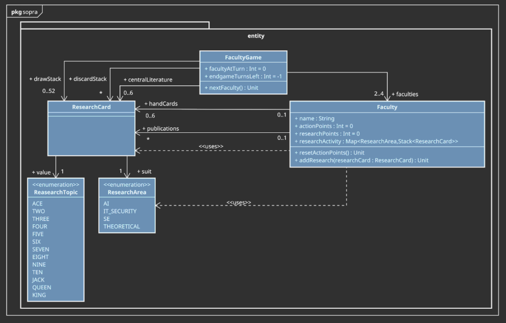
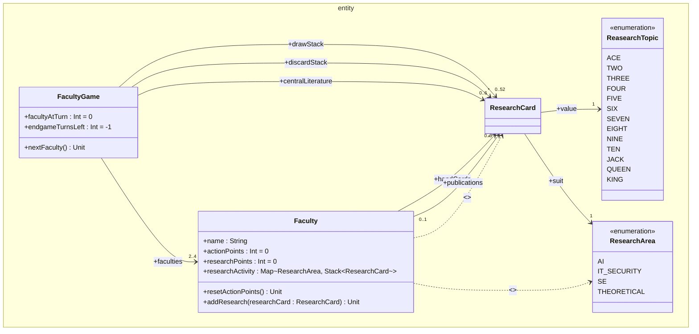

# Exzellente Informatik-Forschung

Ein taktisches Kartenspiel für 2–4 Personen mit 52 Karten Standardkartendeck

## Spielidee

Ihr leitet konkurrierende **Informatik-Fakultäten** verschiedener Universitäten. Ihr investiert in unterschiedliche **Teilgebiete der Informatik**, baut **Forschungsschwerpunkte** auf und entscheidet, **wann ihr eure Ergebnisse publiziert**. Dabei greift ihr auch auf die **aktuelle Forschungsliteratur** zurück.

Am Ende gewinnt die Fakultät mit der **stärksten Forschungsleistung**.

## Spielmaterial

Ein Standard-Kartendeck (52 Karten, ohne Joker)

### Teilgebiete der Informatik

Die Farben entsprechen vier Teilgebieten:

- ♠ = Künstliche Intelligenz
- ♥ = IT-Sicherheit
- ♦ = Software Engineering
- ♣ = Theoretische Informatik

## Spielaufbau

- Mischt das Deck und legt es als Nachziehstapel bereit.
- Jede Fakultät erhält **5 Handkarten**

### Persönlicher Bereich

Jede Fakultät (d.h., jede/r Spielende) hat vor sich **vier offene Stapel** (je einen pro Teilgebiet), die zu Beginn des Spiels noch leer sind:

- Karten werden im Verlauf des Spiels offen (und ggf. überlappend) abgelegt
- Die Reihenfolge bleibt sichtbar
- Alle Stapel sind jederzeit für alle einsehbar

Zusätzlich gibt es einen **Publikationsstapel** (auch zu Beginn leer), auf dem die für die spätere Wertung relevante Forschungsleistung gesammelt wird.

### Zentrale Literatur

In die Tischmitte wird eine **gemeinsame offene Auslage** gelegt, diese enthält zu **Beginn 6 Karten vom Nachziehstapel**

Die zentrale Auslage repräsentiert den aktuellen Stand der Forschung, der in der eigenen Arbeit verwendet (d.h., zitiert) werden kann. Die zitierte Arbeit "verbraucht" sich hierbei. Immer, wenn eine Karte aus der zentralen Literatur entfernt wird, werden die verbleibenden Karten zusammengerückt, damit neu hinzukommende Karten (siehe Aktion Forschung vorantreiben) dann als die neusten zu erkennen sind.

## Aktionen

Gespielt wird reihum im Uhrzeigersinn. In deinem Zug hast du **2 Aktionspunkte (AP)**. Du kannst Aktionen frei kombinieren, solange du genug AP hast (d.h. insbesondere, dass die gleiche Aktion mehrfach gemacht werden darf)

### Forschung vorantreiben (1 AP)

Spiele eine Karte aus deiner Hand in das passende Teilgebiet und lege die Karte offen auf deinen entsprechenden Stapel

Zusätzlich:

- Ziehe **1 Karte vom Nachziehstapel** und lege sie offen in die zentrale Literatur
- Liegen dort bereits **6 Karten, wird die älteste Karte entfernt**

### Neue Ideen gewinnen (1 AP)

Ziehe eine Karte vom Nachziehstapel auf deine Hand. Das geht nur, falls du höchstens 5 Karten auf der Hand hast (d.h., Handkartenlimit: 6 Karten)

### Strategie anpassen (1 AP)

- Wirf 1 Karte ab
- Ziehe 2 Karten
- Behalte 1, die andere wird abgeworfen

### Publizieren (2 AP)

Sichere deine Ergebnisse in einem Teilgebiet

- Nimm alle Karten eines deiner Stapel, auf dem mindestens 2 Karten liegen.
- Lege sie auf deinen **offenen Publikationsstapel**

Dieser Stapel bleibt für alle einsehbar. Die Karten gelten als veröffentlicht und können nicht mehr beeinflusst werden.

Durch Publizieren werden Punkte generiert:

- 2 Karten: Poster-Präsentation → **3 Punkte**
- 3 Karten: Short Conference Paper → **5 Punkte**
- 4 Karten: Regular Conference Paper → **7 Punkte**
- 5+ Karten: Journal-Artikel → **9 Punkte**

Wenn es sich dabei um die erste Publikation (aller Fakultäten) in diesem Forschungsgebiet handelt, erhält man **1 Zusatzpunkt**.

### Konkurrenz ausbremsen (2 AP)

Entferne die oberste Karte eines Stapels einer anderen Fakultät und lege sie auf den Ablagestapel.

### Literatur nutzen (2 AP)

Nimm eine beliebige Karte aus der zentralen Literatur und lege sie offen auf deinen entsprechenden Stapel

## Spielende

Das Spiel endet, wenn der Nachziehstapel leer ist und danach jede andere Fakultät noch einmal am Zug war.

## Abschließende Wertung

Die während des Spiels durch Publikationen erzielte Forschungsleistung (Punkte) wird am Ende des Spiels noch um Bonuspunkte ergänzt.

### 1. Sichtbarkeit (Mehrheiten)

Für jedes Teilgebiet:

- Meiste Karten aller Fakultäten → **+5 Punkte**
- Zweitmeiste Karten Fakultäten → **+2 Punkte**

Es zählen ausschließlich die Karten auf dem Publikationsstapel.

### 2. Breite Aufstellung

- Mindestens 1 Publikation in allen 4 Teilgebieten → **+3 Punkte**

### 3. Forschungsschwerpunkt

- 8 oder mehr publizierte Karten in einem Teilgebiet → **+4 Punkte**

### 4. Angefangene Forschung

- Jede ausliegende Karte, die nicht im Publikationsstapel ist → **+1 Punkt**

---

## Anforderungen

Das zu entwickelnde Programm soll den Spielablauf steuern und für die Einhaltung der Spielregeln sorgen. Hierbei sollen zusätzliche Features umgesetzt werden, die nicht direkt auf den Spielregeln basieren:

- Bei Programmstart sollen 2–4 Spieler zur Unterscheidung mindestens mit Namen konfiguriert werden können.
- Die Reihenfolge der Spielenden soll vor Spielstart sowohl frei wählbar konfiguriert als auch randomisiert werden können.
- Die Spieler wählen nacheinander und reihum am gleichen Bildschirm ihre Aktionen aus (Hotseat-Modus).
- Es soll ein textueller Log (z.B. in der Konsole) existieren, der mindestens die Spieleraktionen menschenlesbar zusammenfasst.
- Am Ende des Spiels soll das Punkteergebnis angezeigt werden und welche\*r Spieler\*in gewonnen hat.

---

## Klassendiagramm (`pkg sopra` / `entity`)

